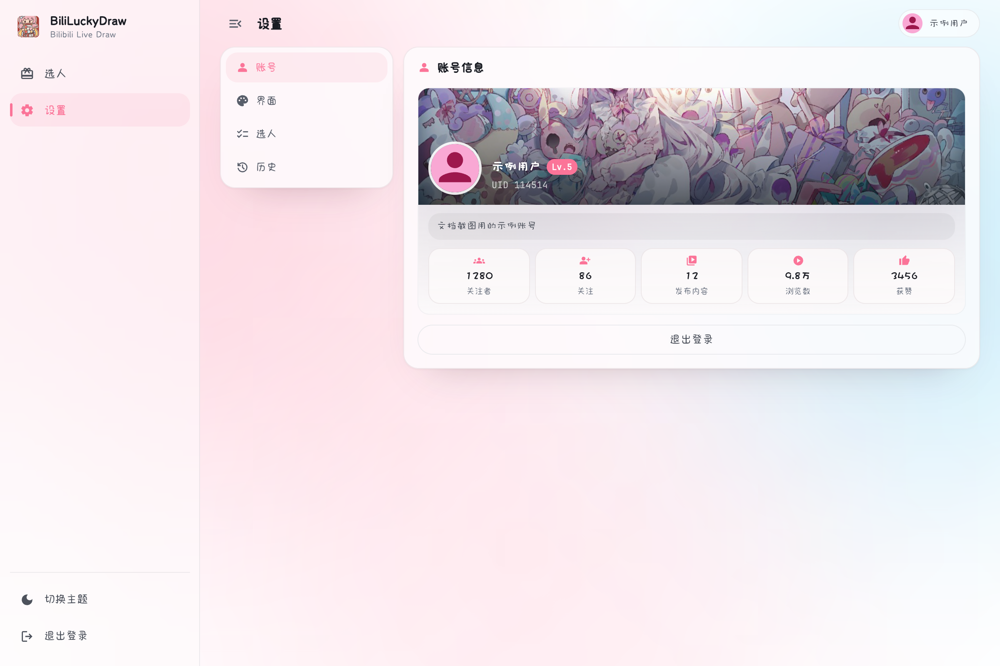
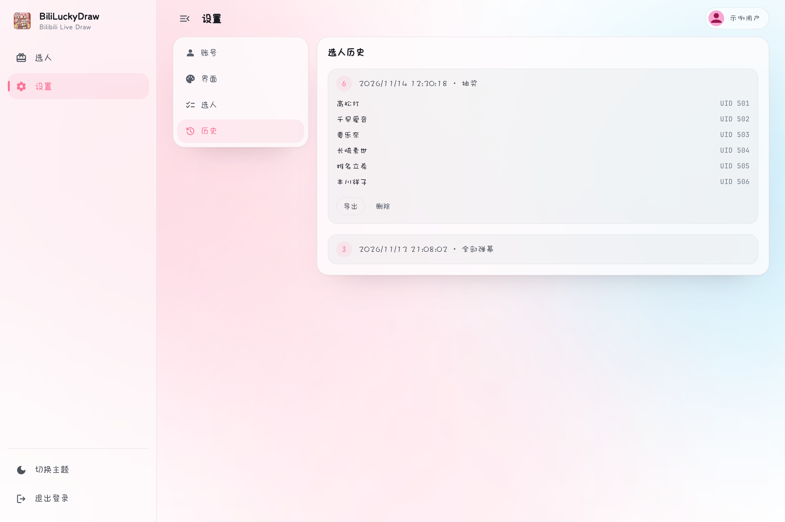

<div align="center">
  

  # BiliLuckyDraw

  基于 Wails v3 + Go + React + TypeScript 的 B 站直播间弹幕抽奖桌面应用

  
  
  
  
  

  **[简体中文](./docs/README.zh-CN.md)** · **[English](./docs/README.en-US.md)**
</div>

---

> 完整文档见 [在线文档](https://adarkmaker.github.io/BiliLuckyDraw/)（或上方语言链接）。简要说明如下。

## 功能特性

- **直播间抽奖**：实时监控弹幕，按口令收集参与观众（UID 去重），随机开奖；口令留空即收集全部弹幕
- **边看边抽**：同一屏内嵌直播画面、频道列表与实时弹幕，弹幕贴底跟随、上滚暂停、静置自动恢复；静默卡流自动重连
- **多种登录方式**：Cookie 登录、B 站 App 扫码登录
- **多配置（Profile）**：多套口令 / 人数 / 频道 / 背景，一键切换
- **历史与导出**：每次开奖自动记录名单，可导出为 Markdown，按配置切换查看
- **主题**：深浅色 + 春节 / 假日背景，主色调随背景图自动取色
- **性能**：图片限并发预解码、CDN 缩略图、可见区懒加载，弹幕刷屏时依旧跟手

## 截图预览

<div align="center">
  <table>
    <tr>
      <td align="center"><br/><sub>选人页</sub></td>
      <td align="center"><br/><sub>登录页</sub></td>
      <td align="center"><br/><sub>扫码登录</sub></td>
    </tr>
    <tr>
      <td align="center"><br/><sub>设置页</sub></td>
      <td align="center"><br/><sub>中奖结果</sub></td>
      <td align="center"><br/><sub>抽奖历史</sub></td>
    </tr>
  </table>
</div>

## 下载

[](https://github.com/aDarkMaker/BiliLuckyDraw/releases)

| 平台 | 文件 |
| --- | --- |
| macOS（通用） | `BiliLuckyDraw-darwin-universal.zip` |
| Windows x64 | `luckydraw-amd64-installer.exe` / `luckydraw-amd64-portable.exe` |

## 快速开始

1. 从 [Releases](https://github.com/aDarkMaker/BiliLuckyDraw/releases) 下载对应平台的安装包
2. 使用 Cookie 或扫码登录
3. 在设置页添加要监控的直播间（支持直贴直播间链接）
4. 在选人页设口令与中选人数，点「开始选人」

## 技术栈

| 层 | 技术 |
| --- | --- |
| 后端 | Wails v3 · Go 1.25 |
| 前端 | React 19 · TypeScript 5 · Vite 6 · Tailwind 3 · HeroUI |
| 直播协议 | 弹幕 WebSocket 二进制帧 · HLS（hls.js） |

## 开发

```bash
git clone https://github.com/aDarkMaker/BiliLuckyDraw.git
cd BiliLuckyDraw/luckydraw
task common:install:frontend:deps   # 安装前端依赖（默认 npm）
task dev                            # 开发模式（热重载 + 浏览器桥接）
task build                          # 构建当前平台可执行文件
task package                        # 打包当前平台
```

> 详细开发与构建说明见 [完整文档](./docs/README.zh-CN.md#开发与构建)。

## 许可证

[MIT License](../LICENSE) © 2025 aDarkMaker
