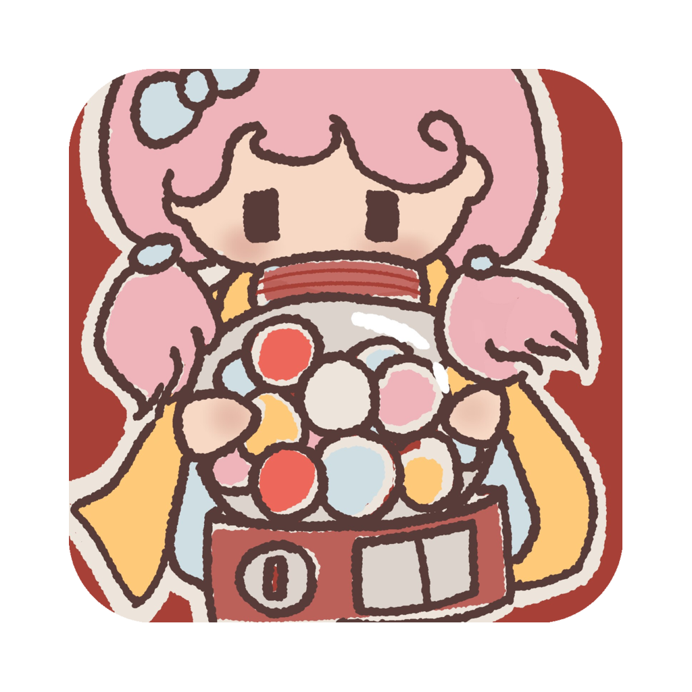
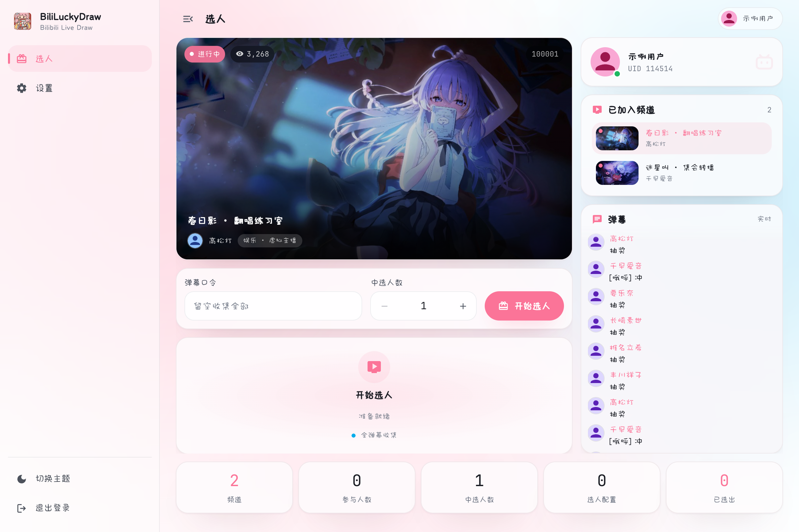
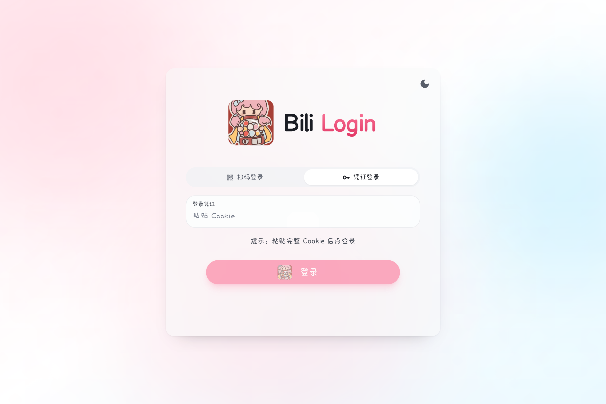
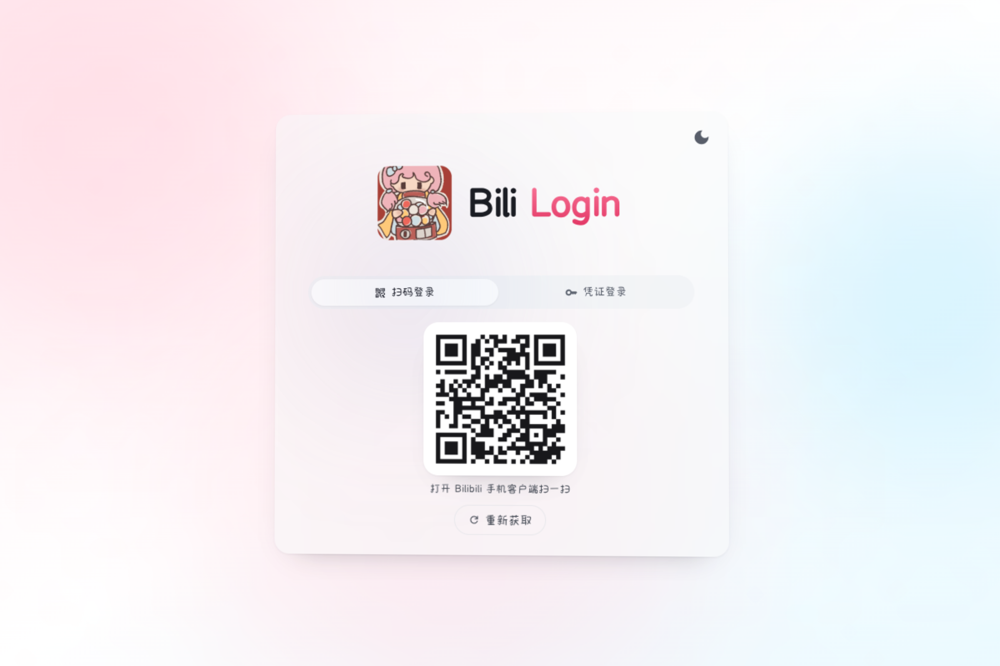
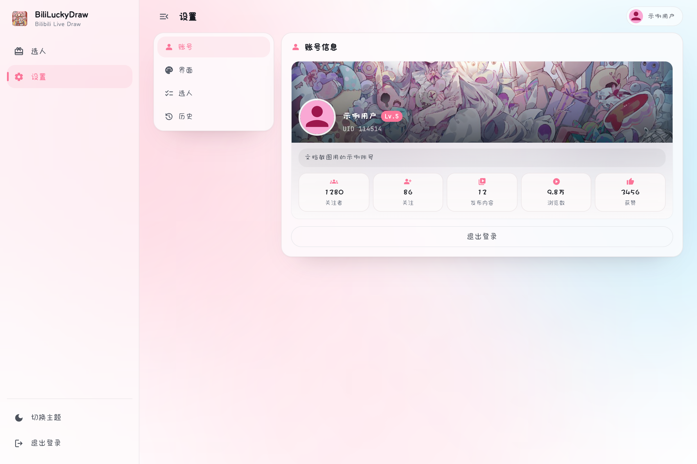
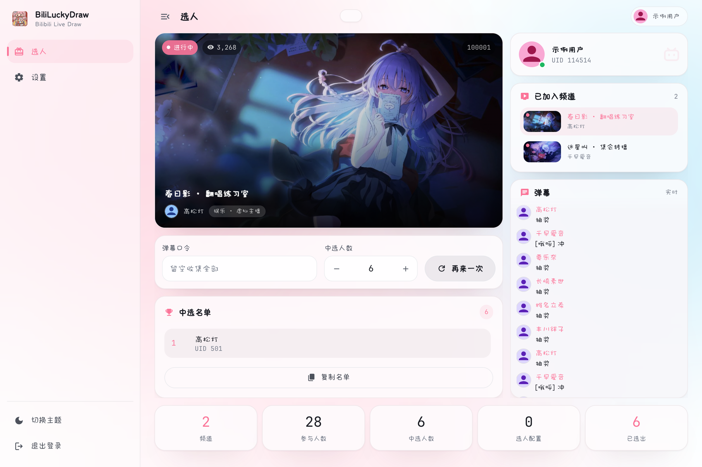
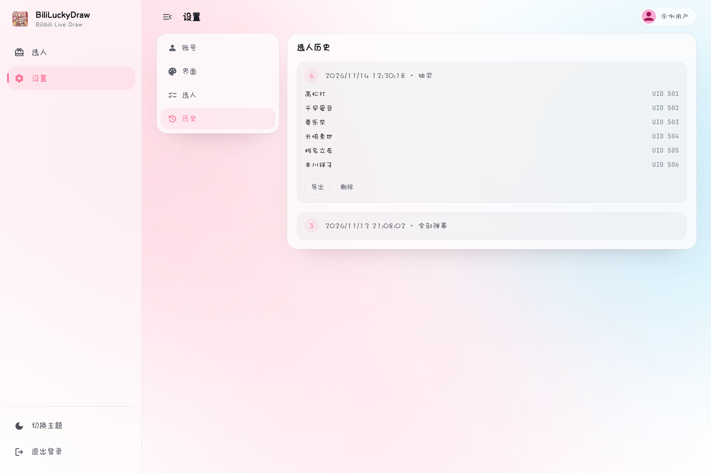

<div align="center">
  

  # BiliLuckyDraw

  A Bilibili live-stream danmaku lucky-draw desktop app built with Wails v3 + Go + React + TypeScript

  
  
  
  
  

  **English** · [简体中文](./README.zh-CN.md)
</div>

---

## Introduction

BiliLuckyDraw is a desktop app for running lucky draws on Bilibili live streams. Once started it monitors danmaku in real time, collects participants by keyword and draws winners at random. Beyond the draw, it also keeps the stream, the room list, the live danmaku feed and the winner list on one screen — no more switching between a browser and a document before going live.

## Features

- **Live-stream draw**: monitor danmaku in real time, collect participants by keyword (deduplicated by UID), draw randomly; an empty keyword collects every danmaku
- **Watch and draw together**: an embedded HLS player plus a live danmaku panel that sticks to the bottom, pauses on scroll-up and resumes after 3 idle seconds; a watchdog rebuilds silently stalled streams
- **Multiple login methods**: cookie login, Bilibili-app QR-code login (with expired and awaiting-confirmation states)
- **Multi-profile**: multiple keyword / winner count / rooms / background / history sets, switchable in one click
- **History and export**: every draw is recorded automatically and exportable as Markdown, per profile
- **Themes**: light and dark at any time, optional spring-festival and beach backdrops, with the accent sampled from the active image
- **Performance**: throttled image pre-decoding, CDN thumbnails and visibility-gated mounting keep the UI responsive during bursts

## Screenshots

<div align="center">
  <table>
    <tr>
      <td align="center"><br/><sub>Lottery</sub></td>
      <td align="center"><br/><sub>Login</sub></td>
      <td align="center"><br/><sub>QR login</sub></td>
    </tr>
    <tr>
      <td align="center"><br/><sub>Settings</sub></td>
      <td align="center"><br/><sub>Winners</sub></td>
      <td align="center"><br/><sub>History</sub></td>
    </tr>
  </table>
</div>

## Quick Start

1. **Download**: grab the installer for your platform from [Releases](https://github.com/aDarkMaker/BiliLuckyDraw/releases)
2. **Log in**: via cookie or QR code
3. **Configure rooms**: add the rooms you want to monitor in Settings — pasting a live-room link works too
4. **Start the draw**: set the keyword and winner count, click start, watch the count rise, stop to draw

## Download

- **[GitHub Releases](https://github.com/aDarkMaker/BiliLuckyDraw/releases)**

| Platform | File |
| --- | --- |
| macOS (universal) | `BiliLuckyDraw-darwin-universal.zip` |
| Windows x64 | `luckydraw-amd64-installer.exe` / `luckydraw-amd64-portable.exe` |

## Tech Stack

| Layer | Stack |
| --- | --- |
| Backend | Wails v3 · Go 1.25 |
| Frontend | React 19 · TypeScript 5 · Vite 6 · Tailwind 3 · HeroUI |
| Live protocols | Danmaku WebSocket binary frames · HLS (hls.js) |
| Storage | Local JSON under `~/.luckydraw/` |

## Project Structure

```
luckydraw/
  main.go                  # Wails v3 entry (embeds frontend dist)
  Taskfile.yml             # build workflow (dev/build/package/generate)
  build/                   # per-platform config, Taskfiles and icons
  cmd/devbridge/           # standalone browser bridge (reuses /api routes)
  internal/
    app/                   # thin Wails service layer (only pkg importing wails/v3)
    service/               # pure business logic (auth/live/profile/room/danmaku/emote/history)
    live/                  # danmaku protocol and draw aggregation
    bili/                  # Bilibili HTTP API + WBI signing
    login/                 # QR-code login
    config/                # config persistence and migration
    event/                 # Emitter interface (decouples service from Wails)
    devbridge/             # browser HTTP transport and /api routes
  frontend/
    src/
      features/            # session / lottery / rooms / profiles / settings / history
      components/ theme/   # shared components, theme and accent extraction
      services/            # HTTP fallback, bridge probe, QR, clipboard
    scripts/               # icon generation and checks (local only, not committed)
    bindings/              # generated by wails3 generate bindings (do not edit)
```

## Development & Build

### Prerequisites

- Go 1.25+
- Node.js 22+ (npm is the default package manager; bun / pnpm / yarn also work)
- Wails v3 CLI: `go install github.com/wailsapp/wails/v3/cmd/wails3@v3.0.0-alpha.95`
- Task: `go install github.com/go-task/task/v3/cmd/task@latest`

### Local Development

```bash
git clone https://github.com/aDarkMaker/BiliLuckyDraw.git
cd BiliLuckyDraw/luckydraw
task common:install:frontend:deps   # install frontend deps
task dev                            # dev mode (hot reload, plus a browser bridge on 127.0.0.1:9246)
```

To run only the frontend in a browser, start the bridge separately:

```bash
go run ./cmd/devbridge
```

### Build & Package

```bash
task build                        # build the current platform into bin/
task darwin:package:universal     # package a universal macOS .app
task windows:build ARCH=amd64     # cross-compile the Windows exe
task windows:package ARCH=amd64   # produce the Windows NSIS installer
task common:generate:bindings     # regenerate frontend bindings after backend changes
```

> The local release flow (no CI required) is documented in `docs/development/build.md`.

## Notes

- Frontend bindings live in `frontend/bindings/`, generated by `wails3 generate bindings` — **do not hand-edit**
- The frontend has two transports, Wails IPC and HTTP `/api`, unified by `fallback` in `services/http.ts`; business code is written once
- Colors always go through CSS variables (`--heroui-*`, `--surface`, `--well`); no literal colors in components
- Backend layering: `app` (Wails boundary) → `service` (pure logic) → `live` / `bili` / `config`; `app` is the only package importing `wails/v3`

## License

[MIT License](../../LICENSE) © 2025 aDarkMaker
