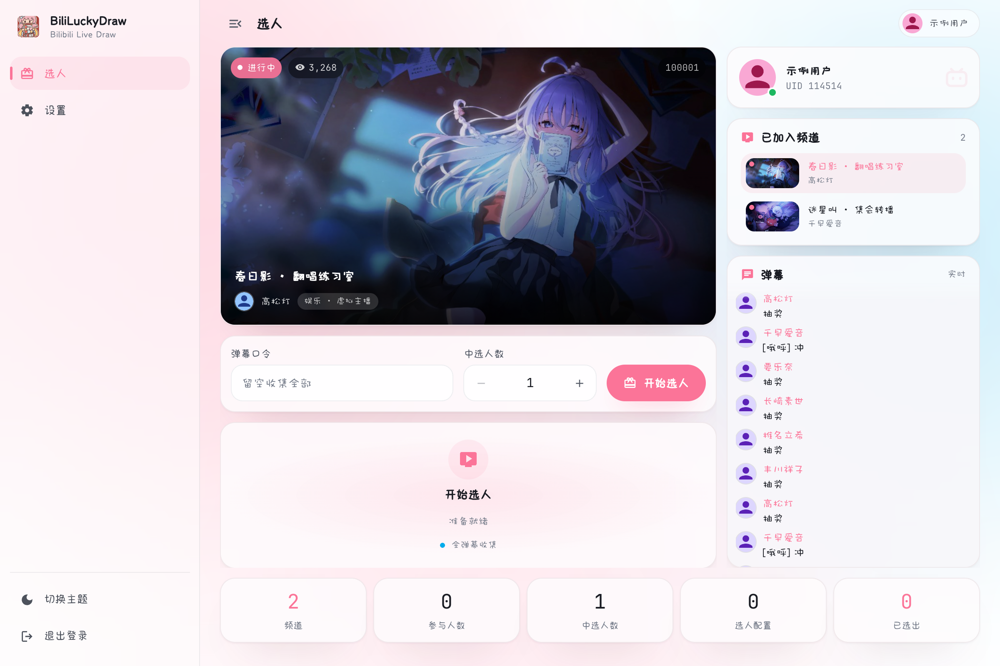
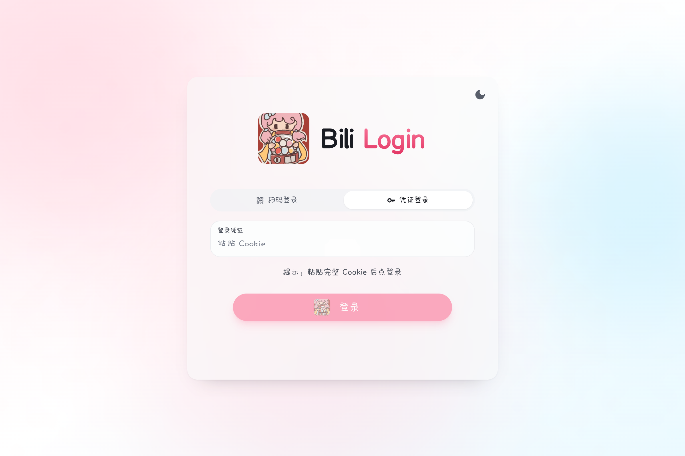
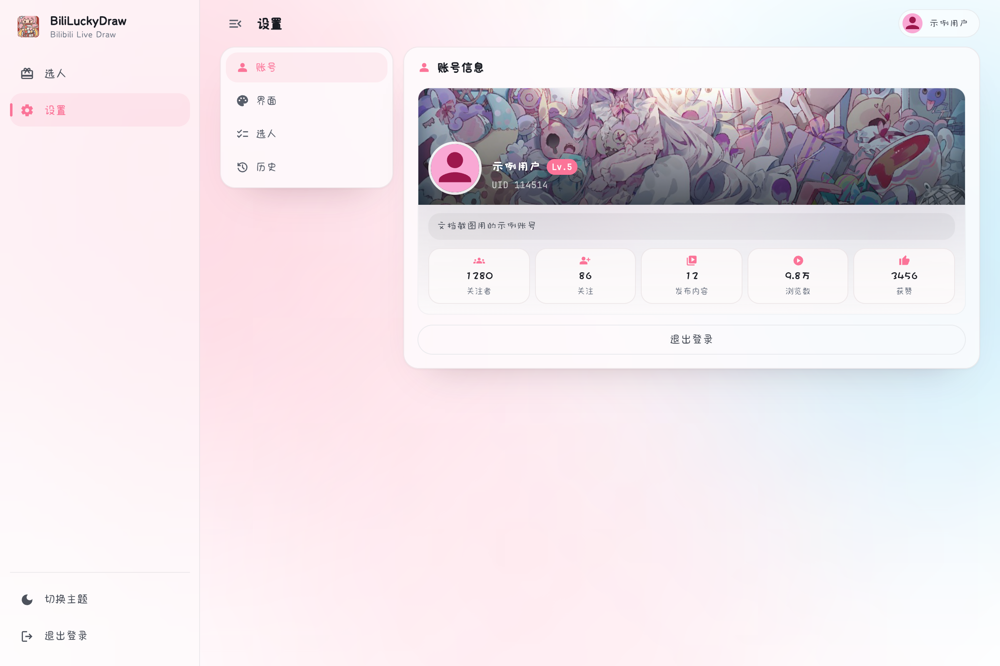
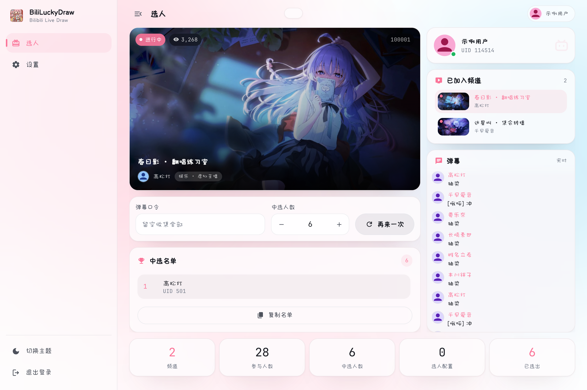
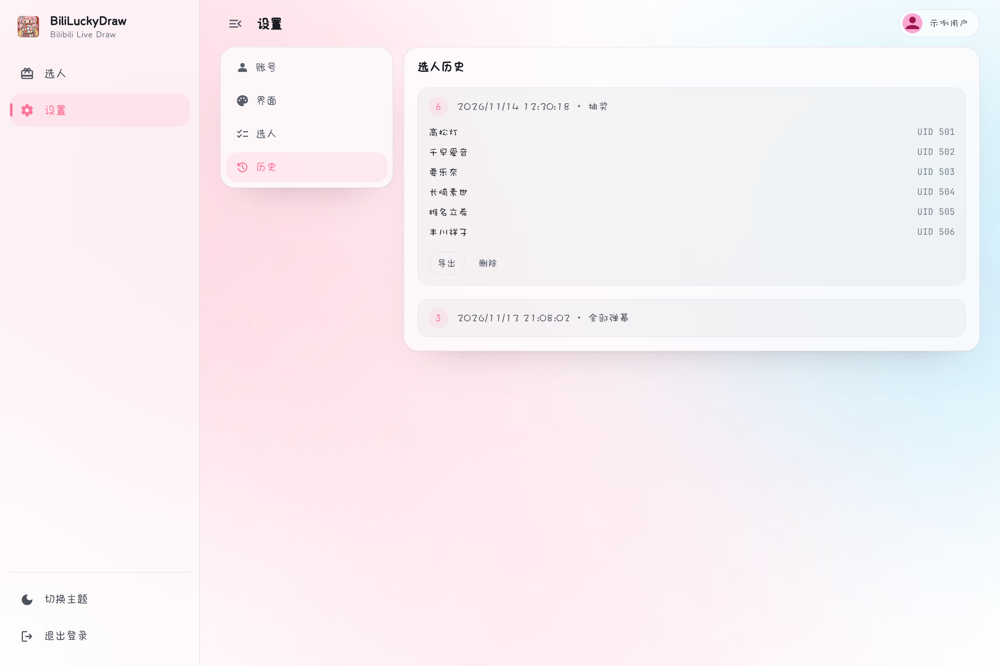

<div align="center">
  

  # BiliLuckyDraw

  基于 Wails v3 + Go + React + TypeScript 的 B 站直播间弹幕抽奖桌面应用

  
  
  
  
  

  [English](./README.en-US.md) · **简体中文**
</div>

---

## 简介

BiliLuckyDraw 是一个 B 站直播弹幕抽奖桌面应用。开启后实时监控直播间弹幕，按口令收集参与观众，随机抽取中奖者。除了抽奖，它还把直播画面、频道列表、实时弹幕和中奖名单收进同一个界面，开播前不用在浏览器和文档之间来回切。

## 功能特性

- **直播间抽奖**：实时监控弹幕，按口令收集参与观众（按 UID 去重），随机开奖；口令留空即收集全部弹幕
- **边看边抽**：内嵌 HLS 播放器与实时弹幕面板，弹幕贴底跟随、上滚暂停、静置 3 秒自动恢复，静默卡流由看门狗自动重建
- **多种登录方式**：Cookie 登录、B 站 App 扫码登录（含过期与待确认提示）
- **多配置（Profile）**：多套口令 / 中选人数 / 频道 / 背景 / 历史，一键切换
- **历史与导出**：每次开奖自动记录名单，可导出为 Markdown，按配置切换查看
- **主题**：深浅色随时切换，春节 / 假日背景可选，主色调从背景图自动取色
- **性能**：图片限并发预解码、CDN 缩略图、可见区懒加载，弹幕刷屏时界面依旧跟手

## 截图预览

<div align="center">
  <table>
    <tr>
      <td align="center"><br/><sub>选人页</sub></td>
      <td align="center"><br/><sub>登录页</sub></td>
      <td align="center"><br/><sub>扫码登录</sub></td>
    </tr>
    <tr>
      <td align="center"><br/><sub>设置页</sub></td>
      <td align="center"><br/><sub>中奖结果</sub></td>
      <td align="center"><br/><sub>抽奖历史</sub></td>
    </tr>
  </table>
</div>

## 快速开始

1. **下载安装包**：从 [Releases](https://github.com/aDarkMaker/BiliLuckyDraw/releases) 下载对应平台的安装文件
2. **登录**：凭证登录或扫码登录
3. **配置频道**：在设置页添加要监控的直播间，直接粘贴直播间链接也可以
4. **开始选人**：设好口令与中选人数后点开始，参与人数实时上涨，停止即开奖

## 下载方式

- **[GitHub Releases](https://github.com/aDarkMaker/BiliLuckyDraw/releases)**

| 平台 | 文件 |
| --- | --- |
| macOS（通用） | `BiliLuckyDraw-darwin-universal.zip` |
| Windows x64 | `luckydraw-amd64-installer.exe` / `luckydraw-amd64-portable.exe` |

## 技术栈

| 层 | 技术 |
| --- | --- |
| 后端 | Wails v3 · Go 1.25 |
| 前端 | React 19 · TypeScript 5 · Vite 6 · Tailwind 3 · HeroUI |
| 直播协议 | 弹幕 WebSocket 二进制帧 · HLS（hls.js） |
| 存储 | 本机 JSON（`~/.luckydraw/`） |

## 目录结构

```
luckydraw/
  main.go                  # Wails v3 入口（embed 前端 dist）
  Taskfile.yml             # 构建工作流（dev/build/package/generate）
  build/                   # 各平台构建配置、Taskfile 与图标
  cmd/devbridge/           # 独立浏览器桥接（复用 /api 路由）
  internal/
    app/                   # 薄 Wails 服务层（唯一 import wails/v3）
    service/               # 纯业务逻辑（auth/live/profile/room/danmaku/emote/history）
    live/                  # 弹幕协议与抽奖聚合
    bili/                  # B 站 HTTP API + WBI 签名
    login/                 # 扫码登录
    config/                # 配置读写与迁移
    event/                 # Emitter 接口（与 Wails 解耦）
    devbridge/             # 浏览器 HTTP 传输与 /api 路由
  frontend/
    src/
      features/            # session / lottery / rooms / profiles / settings / history
      components/ theme/   # 通用组件、主题与主色提取
      services/            # HTTP fallback、桥接探测、二维码、剪贴板
    scripts/               # 图标生成与校验（本地脚本，不入库）
    bindings/              # wails3 generate bindings 生成（勿手改）
```

## 开发与构建

### 环境要求

- Go 1.25+
- Node.js 22+（默认包管理器 npm，也支持 bun / pnpm / yarn）
- Wails v3 CLI：`go install github.com/wailsapp/wails/v3/cmd/wails3@v3.0.0-alpha.95`
- Task：`go install github.com/go-task/task/v3/cmd/task@latest`

### 本地开发

```bash
git clone https://github.com/aDarkMaker/BiliLuckyDraw.git
cd BiliLuckyDraw/luckydraw
task common:install:frontend:deps   # 安装前端依赖
task dev                            # 开发模式（热重载，另起 127.0.0.1:9246 浏览器桥接）
```

只想在浏览器里跑前端时，单独启动桥接：

```bash
go run ./cmd/devbridge
```

### 构建与打包

```bash
task build                        # 构建当前平台可执行文件
task darwin:package:universal     # 打包 macOS 通用 .app
task windows:build ARCH=amd64     # 交叉编译 Windows exe
task windows:package ARCH=amd64   # 生成 Windows NSIS 安装包
task common:generate:bindings     # 改后端方法后重新生成前端绑定
```

> 本地发布流程（不依赖 CI）见 `docs/development/build.md`。

## 开发说明

- 前端绑定位于 `frontend/bindings/`，由 `wails3 generate bindings` 生成，**勿手改**
- 前端有两条通道：Wails IPC 与 HTTP `/api`，由 `services/http.ts` 的 `fallback` 统一封装，业务代码只写一份
- 颜色一律走 CSS 变量（`--heroui-*`、`--surface`、`--well`），组件内不写死色值
- 后端分层：`app`（Wails 边界）→ `service`（纯业务）→ `live` / `bili` / `config`；`app` 是唯一 import `wails/v3` 的包

## 许可证

[MIT License](../../LICENSE) © 2025 aDarkMaker
