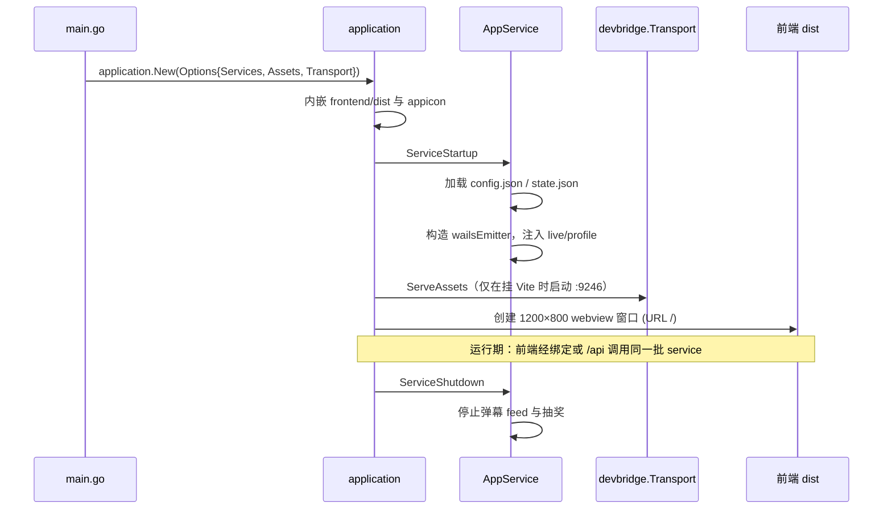
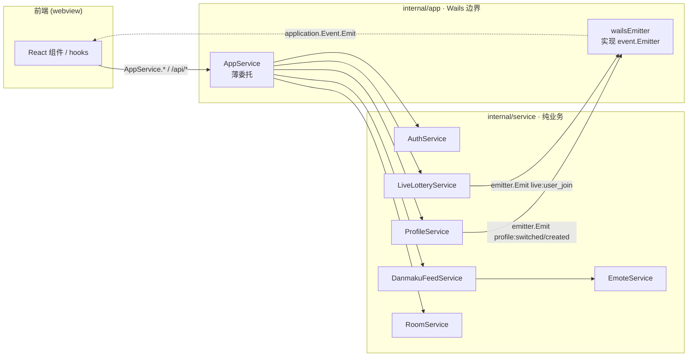

# 后端架构

## 入口 main.go

`application.New` 注册一个服务 `application.NewService(app.New())`，内嵌前端 dist 与应用图标，创建 1200×800 webview 窗口（URL `/`）。同时把 `Transport` 换成 `devbridge.New(appSvc)`，这样桌面窗口走 Wails IPC、浏览器标签页走 HTTP 桥接。

`ApplicationShouldTerminateAfterLastWindowClosed` 在设置了 `FRONTEND_DEVSERVER_URL` 时返回 false，让进程（以及浏览器桥接）在 Vite 调试期间继续存活。

## app 层（Wails 边界）

`AppService` 是暴露给前端的唯一服务，持有六个 service 与 `app *application.App`：

| 字段 | 类型 | 职责 |
| --- | --- | --- |
| `auth` | `*service.AuthService` | 登录、账号信息、Cookie 持久化 |
| `live` | `*service.LiveLotteryService` | 抽奖运行态、参与者池、开奖 |
| `danmaku` | `*service.DanmakuFeedService` | 单房间实时弹幕流 |
| `emote` | `*service.EmoteService` | 表情映射表 |
| `profile` | `*service.ProfileService` | Profile、频道、背景、历史 |
| `room` | `*service.RoomService` | 房间元信息与播放地址 |

- `ServiceStartup`：加载 `~/.luckydraw/config.json` 与 `state.json`，用 `application.Get()` 拿到 app，构造 `wailsEmitter` 并注入 `live`/`profile`（`auth` 不需要事件）。
- `ServiceShutdown`：先停 `danmaku`，再停 `live`。
- `ServiceName` 返回 `"App"`。

`wailsEmitter` 实现 `event.Emitter`，委托 `application.App.Event.Emit`；service 全程不 import Wails。

## service 层（纯业务）

| Service | 依赖 | 说明 |
| --- | --- | --- |
| `AuthService` | `*bili.Client`、`*config.Config`、configPath | 启动时用已存 Cookie 校验；`-101`/`-400` 时清空并落盘 |
| `LiveLotteryService` | `*live.LiveLottery`、`Emitter`、`func() *bili.Client` | 连接房间、开关抽奖、发 `live:user_join` |
| `DanmakuFeedService` | `*bili.Client`、`*EmoteService` | 单房间弹幕采集，环形缓冲 200 条，带游标 |
| `EmoteService` | `*bili.Client` | 拉取回复表情 + 直播间表情，6 小时缓存 |
| `ProfileService` | `*config.RuntimeState`、statePath、`Emitter` | Profile CRUD、频道、背景、历史（每配置上限 100 条） |
| `RoomService` | `func() *bili.Client` | 房间信息与播放地址，45 秒缓存 |

几个值得记住的实现点：

- **弹幕采集与抽奖是两条独立链路**：`DanmakuFeedService` 只服务右侧弹幕面板，按房间单独连接；`LiveLotteryService` 为参与池建立自己的连接。面板切房间不会影响正在跑的抽奖。
- **弹幕缓冲用游标**：前端带 `since` 轮询，服务端只返回游标之后的行，避免重复渲染。
- **表情索引在服务端合并**：先拉全站回复表情，再叠加当前直播间表情；前端只负责把 `[名称]` token 映射成图片。
- **历史写入在 `app` 层**：`AppService.DrawWinners` 拿到结果后调用 `profile.AddHistory`，失败原因存进 `lastHistoryError` 由前端一次性取走。

## event / 配置

- `event.Emitter.Emit(name string, data ...any) bool`，由 `app.wailsEmitter` 实现。
- 事件：`live:user_join`（新参与者）、`profile:switched`、`profile:created`。

| 类型 | 内容 | 文件 |
| --- | --- | --- |
| `Config` | `{Cookie}` | `~/.luckydraw/config.json` |
| `RuntimeState` | `{Profiles, ActiveProfile}` | `~/.luckydraw/state.json` |
| `ProfileConfig` | `{ID, Name, BackgroundImage, WatchedRooms, Keyword, WinnerCount, History}` | state.json 内 |
| `HistoryRecord` | `{ID, Keyword, WinnerCount, Time, Winners}` | state.json 内 |

两个文件都以 `0600` 写入、目录 `0700`。`migrateOldState` 兼容只有单套配置的旧格式。

## live / bili / login

- `bili`：HTTP 客户端 + `SignWBI`。`GetMyInfo` 返回账号信息；WBI 密钥取自 `web-interface/nav` 并缓存。
- `live`：
  - `types.go` 协议常量与数据结构（16 字节包头、op 2/3/5/7/8）。
  - `protocol.go` 组包 / 解包（含 zlib 压缩体）。
  - `room_auth.go` 取房间信息与弹幕主机（WBI 签名，`wss_port` 优先）。
  - `parse.go` 解析 `DANMU_MSG`、进场 / 关注消息与表情 token。
  - `client.go` 连接、鉴权、心跳、重连退避。
  - `lottery.go` 参与者池（按 UID 去重）与 Fisher-Yates 开奖。
- `login`：扫码流程 `GetQRCode` / `CheckQRCodeStatus`，状态码 `0` 成功、`86038` 过期、`86090` 已扫描待确认。

握手要点：`getDanmuInfo` 需要 WBI 签名（`w_rid` / `wts`）；握手包必须带登录 `uid`、`key` 与 `buvid3`（Cookie 里没有时从 `frontend/finger/spi` 取），否则 B 站会打码昵称并把 `uid` 归零，导致所有观众被合并成同一个人。

## 浏览器桥接 internal/devbridge

`Transport` 包住 Wails 默认的 `HTTPTransport`，额外提供一层 JSON API：

| 路由 | 方法 | 对应能力 |
| --- | --- | --- |
| `/api/session` | GET | 登录态与账号信息 |
| `/api/login`、`/api/login/qr` | POST | 凭证登录、扫码登录 |
| `/api/logout` | POST | 登出 |
| `/api/qr`、`/api/qr/status` | GET | 二维码与轮询状态 |
| `/api/rooms` | GET / POST / DELETE | 列出、添加、移除频道 |
| `/api/rooms/info`、`/api/rooms/play` | GET | 房间信息、播放地址 |
| `/api/lottery/connect`、`/start`、`/stop`、`/draw` | POST | 连接、开始、停止、开奖 |
| `/api/lottery/status` | GET | 运行态与参与人数（兼作桥接探活） |
| `/api/lottery/history-error` | GET | 取走并清空最近一次历史写入错误 |
| `/api/danmaku/watch` | POST | 订阅某房间弹幕 |
| `/api/danmaku` | GET / DELETE | 按 `since` 拉取、停止订阅 |
| `/api/danmaku/emotes` | GET | 表情映射 |
| `/api/clipboard` | POST | 系统剪贴板兜底 |

`APIHandler()` 把这套路由单独暴露出来，`cmd/devbridge` 直接挂载它，因此独立二进制与 Wails 开发传输层的行为完全一致。桥接只在 `FRONTEND_DEVSERVER_URL` 非空时监听 `127.0.0.1:9246`，并带 20 次重试以容忍上一次进程尚未释放端口。

## 前端可见方法

`AppService` 暴露的全部方法，前端既可通过生成绑定调用，也可经 `/api` 访问对应路由。

| 方法 | 领域 | 说明 |
| --- | --- | --- |
| `Login` / `LoginWithQRCode` | auth | 校验并持久化 Cookie |
| `GetQRCode` / `CheckQRCodeStatus` | auth | 二维码生成与轮询 |
| `IsLoggedIn` / `GetAccountInfo` / `Logout` | auth | 会话状态与登出 |
| `ConnectLiveRooms` / `StartLiveLottery` / `StopLiveLottery` | live | 抽奖生命周期，`StartLiveLottery` 返回连接结果 |
| `DrawWinners` / `GetParticipantCount` / `IsLiveLotteryRunning` | live | 开奖、人数、运行态 |
| `GetLastHistoryError` / `CopyText` | live | 历史写入错误、原生剪贴板 |
| `WatchDanmaku` / `StopDanmaku` / `GetDanmakuFeed` / `GetEmoteMap` | danmaku | 实时弹幕面板 |
| `GetRoomInfo` / `GetRoomPlayURL` | room | 房间元信息与 HLS 地址 |
| `GetProfiles` / `SwitchProfile` / `CreateProfile` / `DeleteProfile` / `RenameProfile` | profile | 配置管理 |
| `SaveProfileConfig` / `SetBackgroundImage` / `GetBackgroundImage` | profile | 口令、人数、背景 |
| `AddWatchedRoom` / `RemoveWatchedRoom` / `GetWatchedRooms` | profile | 频道管理 |
| `GetHistory` / `DeleteHistory` / `DeleteAllHistory` / `ExportHistory` | history | 历史读取、删除、导出 |

返回复杂结构的方法统一返回 JSON 字符串，前端 `parseJSON` 解析；这也是两条通道能共用同一份前端 API 封装的原因。
