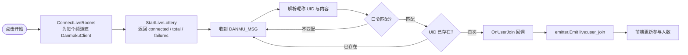
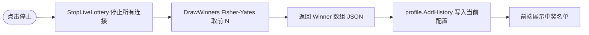
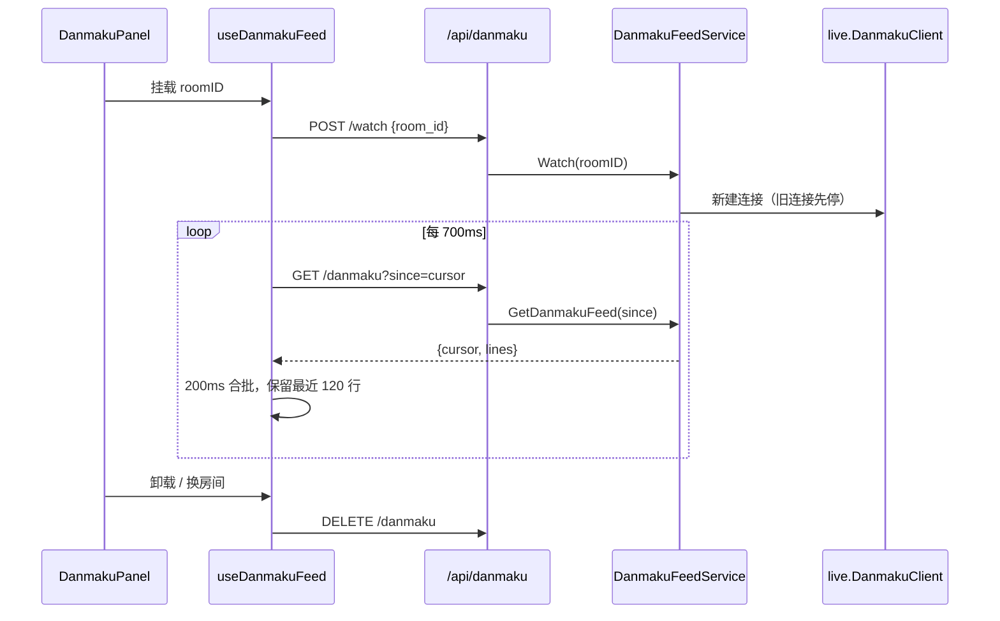
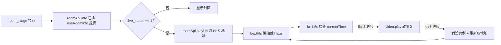
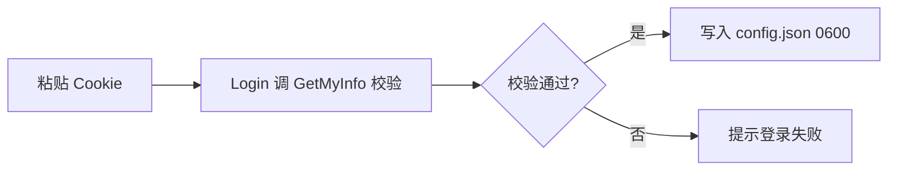
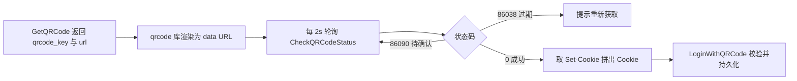
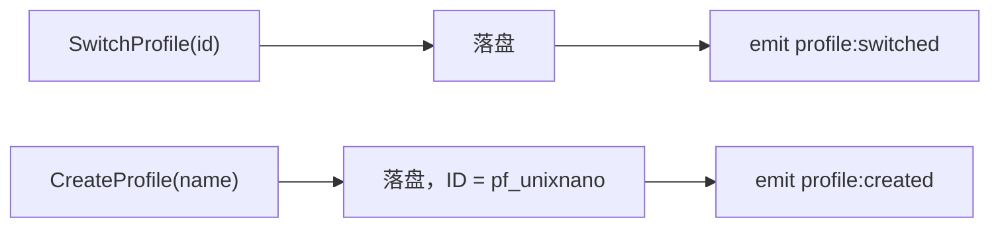

# 数据流与事件

## 抽奖流程

口令为空时 `Match` 直接通过，即「全弹幕收集」。连接失败的频道会出现在 `failures` 里，前端提示具体房间号，而不是静默当作积累中。

`live:user_join` 驱动实时人数；`useLottery` 另有 2 秒轮询兜底，检查运行态与人数，处理事件丢失或页面刷新后的补对账。

## 停止与开奖

历史写入失败不阻塞展示：错误存进 `lastHistoryError`，前端通过 `GetLastHistoryError` 取一次并弹出提示。

## 弹幕面板

表情映射单独取一次（`/api/danmaku/emotes`），服务端缓存 6 小时并叠加当前直播间表情。

## 直播播放

## 登录流程

**凭证登录：**

**扫码登录：**

## Profile 事件

payload 都是对应 `ProfileConfig` 的 JSON 字符串。

## 配置持久化

| 文件 | 内容 |
| --- | --- |
| `~/.luckydraw/config.json` | `{Cookie}` |
| `~/.luckydraw/state.json` | `{Profiles, ActiveProfile}` |

- 口令与中选人数变更后 400ms 防抖调用 `SaveProfileConfig`。
- 频道、背景、配置增删改与开奖历史立即落盘。
- 两个文件均以 `0600` 写入，目录 `0700`；旧版单配置格式在读取时自动迁移。
