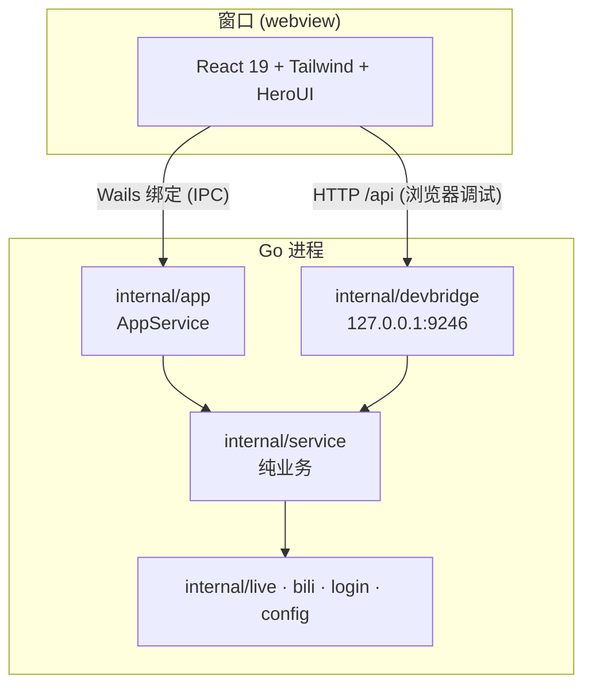
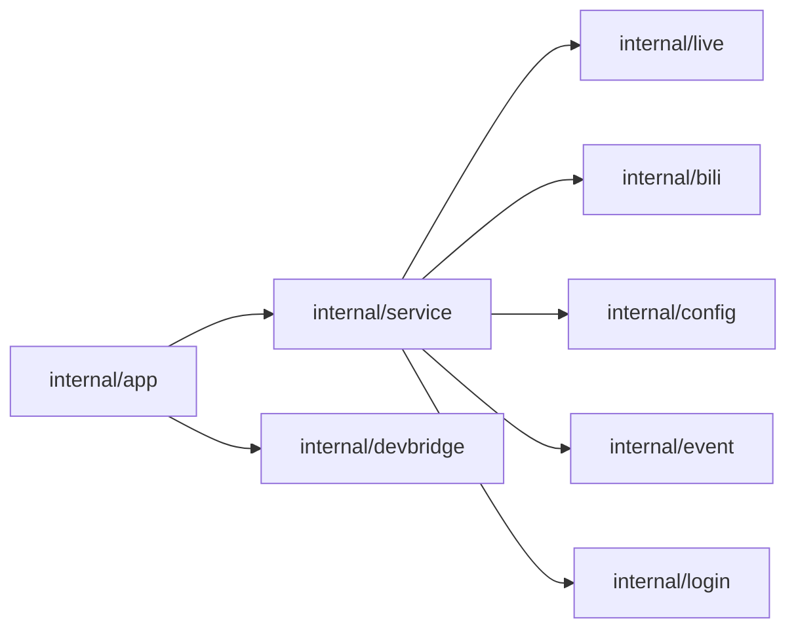

# 架构总览

BiliLuckyDraw 是一个 Wails v3 桌面应用：Go 后端通过 `//go:embed all:frontend/dist` 内嵌 React 前端构建产物，在 1200×800 的 webview 单窗口中渲染。macOS 下关闭最后一个窗口即退出应用；挂上 Vite 开发服务器时保持进程存活，方便浏览器调试。

## 整体形态



前端有两条通道，`services/http.ts` 里的 `fallback(remote, http)` 负责选择：

1. **Wails 绑定**：桌面窗口内正常走的路径，`Call.ByID` 直连 `AppService`。
2. **HTTP 桥接**：浏览器标签页里没有 `_wails` 运行时，或绑定调用失败时，改走 `http://127.0.0.1:9246/api/*`。Vite 把 `/api` 与 `/wails` 代理到该端口。

两条通道最终落在同一份业务代码上：`devbridge.Transport.APIHandler()` 暴露的路由与 `AppService` 方法一一对应。

## 后端分层



- `app`：唯一 import `wails/v3` 的包。`AppService` 是暴露给前端的单一服务，所有方法薄委托 `service`，并持有窗口、剪贴板、文件对话框等 Wails 能力。
- `service`：纯 Go 业务逻辑，按领域拆成 `auth` / `live` / `profile` / `room` / `danmaku_feed` / `emote` / `history`，不依赖 Wails。
- `live`：弹幕 WebSocket 二进制协议与抽奖聚合，同包内按职责拆文件（`types` / `protocol` / `room_auth` / `parse` / `client` / `lottery`）。
- `bili`：B 站 HTTP API 客户端与 WBI 签名。
- `config`：本机 JSON 配置的读写与旧版本迁移。
- `event`：`Emitter` 接口，让 `service` 不直接依赖 Wails，由 `app` 层注入实现。
- `devbridge`：浏览器调试用的 HTTP 传输层与 JSON API 路由。
- `cmd/devbridge`：独立的桥接可执行文件，复用同一套 API 路由，无需启动 Wails。

## 前端结构

按功能域切分，`features/` 下每个目录自带 API、hook 与组件：

```
src/
  features/
    session/     # 登录页、扫码 / 凭证登录、会话 hook
    lottery/     # 选人页、控制条、中奖名单、抽奖 hook
    rooms/       # 频道列表、直播播放器、弹幕面板、HLS 加载、表情渲染
    profiles/    # 抽奖配置（Profile）的 CRUD 与切换
    settings/    # 设置页与四个页签
    history/     # 历史列表与记录组件
  components/    # 通用件：Panel / Icon / CachedImage / 滚动钩子 / Toast
  theme/         # 深浅色 + 背景预设 + 主色提取
  services/      # HTTP fallback、桥接探测、二维码与剪贴板
  types/         # 按域拆分的类型声明
  config/        # 站点导航配置
  contexts/      # AppContext（会话 + 配置 + 抽奖合并）
```

页面通过 `AppProvider` 合并三个 hook 的状态：`useSession`（登录态）、`useProfiles`（配置与频道）、`useLottery`（抽奖运行态），再经 `useApp()` 分发。路由由 `react-router-dom` 管理，`/` 是选人页，`/settings` 是设置页。

## 目录结构

```
luckydraw/
  main.go                  # Wails v3 入口（embed 前端 dist）
  Taskfile.yml             # 构建工作流（dev/build/package/generate）
  build/                   # 各平台构建配置、Taskfile 与图标
  cmd/devbridge/           # 独立浏览器桥接
  internal/
    app/                   # Wails 边界：AppService + emitter
    service/               # 纯业务逻辑
    live/                  # 弹幕协议 + 抽奖聚合
    bili/                  # B 站 HTTP API + WBI 签名
    login/                 # 扫码登录
    config/                # 配置读写
    event/                 # Emitter 接口
    devbridge/             # 浏览器 HTTP 传输与路由
  frontend/
    src/                   # 见上一节
    scripts/               # 图标生成与校验（本地脚本，不入库）
    bindings/              # wails3 generate bindings 生成（勿手改）
```

## 运行期要点

- 单窗口应用，侧栏导航；窄窗口下侧栏变成抽屉。
- 前端启动时先探测桥接（`/api/lottery/status`），一次性决定后续走 IPC 还是 HTTP。
- 主题在主色提取完成前使用预设色，读取背景图后通过 canvas 采样覆盖 `--heroui-primary-*` 变量。
