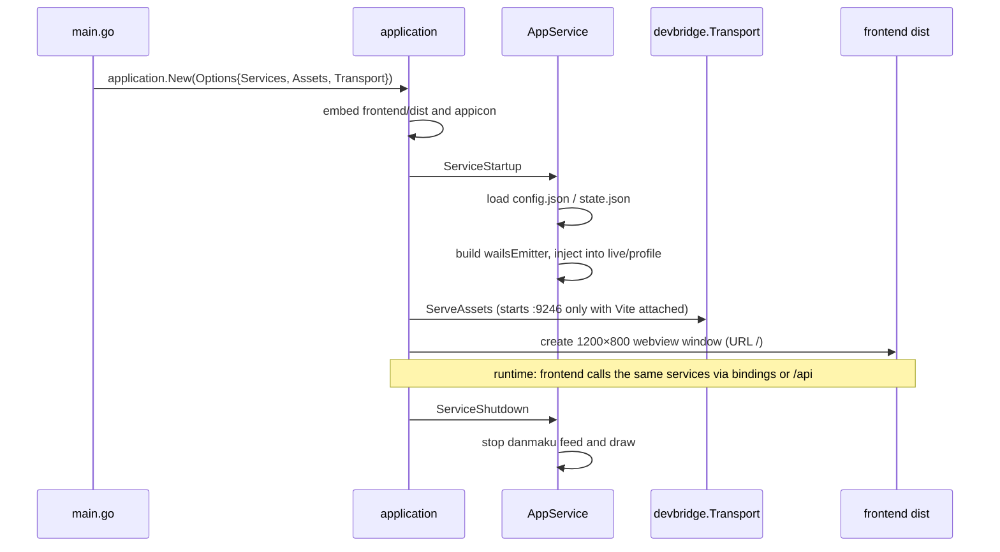
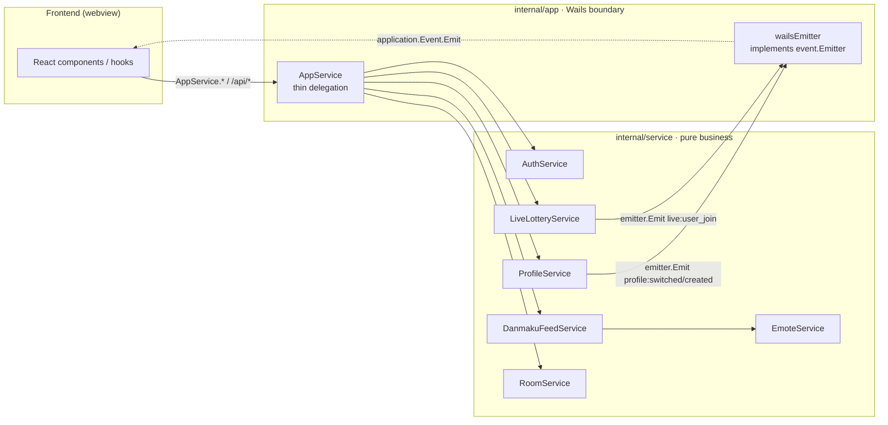

# Backend Architecture

## Entry point: main.go

`application.New` registers one service (`application.NewService(app.New())`), embeds the frontend dist and app icon, and creates a 1200×800 webview window (URL `/`). It also swaps in `devbridge.New(appSvc)` as the transport, so the desktop window uses Wails IPC while a browser tab uses the HTTP bridge.

`ApplicationShouldTerminateAfterLastWindowClosed` returns false when `FRONTEND_DEVSERVER_URL` is set, keeping the process (and the browser bridge) alive during Vite debugging.

## app layer (Wails boundary)

`AppService` is the single service exposed to the frontend. It owns six services and `app *application.App`:

| Field | Type | Responsibility |
| --- | --- | --- |
| `auth` | `*service.AuthService` | login, account info, cookie persistence |
| `live` | `*service.LiveLotteryService` | draw lifecycle, participant pool, drawing |
| `danmaku` | `*service.DanmakuFeedService` | single-room live danmaku feed |
| `emote` | `*service.EmoteService` | emote map |
| `profile` | `*service.ProfileService` | profiles, rooms, background, history |
| `room` | `*service.RoomService` | room metadata and play URL |

- `ServiceStartup`: loads `~/.luckydraw/config.json` and `state.json`, gets the app via `application.Get()`, builds `wailsEmitter` and injects it into `live`/`profile` (`auth` needs no events).
- `ServiceShutdown`: stops `danmaku`, then `live`.
- `ServiceName` returns `"App"`.

`wailsEmitter` implements `event.Emitter` by delegating to `application.App.Event.Emit`; services never import Wails.

## service layer (pure business)

| Service | Dependencies | Notes |
| --- | --- | --- |
| `AuthService` | `*bili.Client`, `*config.Config`, configPath | validates a stored cookie on startup; clears it on `-101`/`-400` |
| `LiveLotteryService` | `*live.LiveLottery`, `Emitter`, `func() *bili.Client` | connects rooms, starts/stops draws, emits `live:user_join` |
| `DanmakuFeedService` | `*bili.Client`, `*EmoteService` | per-room feed, 200-line ring buffer, cursor-based reads |
| `EmoteService` | `*bili.Client` | reply emotes plus room emotes, cached 6 hours |
| `ProfileService` | `*config.RuntimeState`, statePath, `Emitter` | profile CRUD, rooms, background, history (100 per profile) |
| `RoomService` | `func() *bili.Client` | room info and play URL, cached 45 seconds |

Things worth remembering:

- **Collecting danmaku and running a draw are separate pipelines.** `DanmakuFeedService` only powers the right-hand panel and connects per room; `LiveLotteryService` opens its own connections for the participant pool. Switching the previewed room never disturbs a running draw.
- **The feed is cursor-based.** The frontend polls with `since`, and the server returns only newer lines, so nothing is rendered twice.
- **Emotes are merged server-side.** Global reply emotes load first, then the current room's emotes layer on top; the frontend only maps `[name]` tokens to images.
- **History is written in the `app` layer.** After `DrawWinners` succeeds, `AppService` calls `profile.AddHistory`; a failure is stashed in `lastHistoryError` and read once by the frontend.

## Events and config

- `event.Emitter.Emit(name string, data ...any) bool`, implemented by `app.wailsEmitter`.
- Events: `live:user_join` (new participant), `profile:switched`, `profile:created`.

| Type | Contents | File |
| --- | --- | --- |
| `Config` | `{Cookie}` | `~/.luckydraw/config.json` |
| `RuntimeState` | `{Profiles, ActiveProfile}` | `~/.luckydraw/state.json` |
| `ProfileConfig` | `{ID, Name, BackgroundImage, WatchedRooms, Keyword, WinnerCount, History}` | inside state.json |
| `HistoryRecord` | `{ID, Keyword, WinnerCount, Time, Winners}` | inside state.json |

Both files are written with `0600` inside a `0700` directory. `migrateOldState` upgrades the legacy single-profile layout.

## live / bili / login

- `bili`: HTTP client plus `SignWBI`. `GetMyInfo` returns the account; WBI keys come from `web-interface/nav` and are cached.
- `live`:
  - `types.go` — protocol constants and data shapes (16-byte header, ops 2/3/5/7/8).
  - `protocol.go` — packet framing, including zlib-compressed bodies.
  - `room_auth.go` — room info and danmaku hosts (WBI-signed, `wss_port` first).
  - `parse.go` — `DANMU_MSG`, enter/follow messages and emote tokens.
  - `client.go` — connect, authenticate, heartbeat, reconnect backoff.
  - `lottery.go` — UID-deduplicated participant pool and Fisher-Yates draw.
- `login`: the QR flow `GetQRCode` / `CheckQRCodeStatus`; status `0` success, `86038` expired, `86090` scanned awaiting confirmation.

Handshake notes: `getDanmuInfo` requires WBI signing (`w_rid` / `wts`). The handshake packet must carry the logged-in `uid`, `key` and `buvid3` (fetched from `frontend/finger/spi` when the cookie lacks it), otherwise Bilibili masks nicknames and zeroes `uid`, collapsing every viewer into one participant.

## Browser bridge: internal/devbridge

`Transport` wraps Wails' default `HTTPTransport` and adds a JSON API:

| Route | Method | Capability |
| --- | --- | --- |
| `/api/session` | GET | login state and account |
| `/api/login`, `/api/login/qr` | POST | cookie login, QR login |
| `/api/logout` | POST | log out |
| `/api/qr`, `/api/qr/status` | GET | QR code and polling |
| `/api/rooms` | GET / POST / DELETE | list, add, remove rooms |
| `/api/rooms/info`, `/api/rooms/play` | GET | room info, play URL |
| `/api/lottery/connect`, `/start`, `/stop`, `/draw` | POST | connect, start, stop, draw |
| `/api/lottery/status` | GET | run state and participants (also the bridge probe) |
| `/api/lottery/history-error` | GET | read-and-clear the last history write error |
| `/api/danmaku/watch` | POST | subscribe to a room's danmaku |
| `/api/danmaku` | GET / DELETE | poll with `since`, stop |
| `/api/danmaku/emotes` | GET | emote map |
| `/api/clipboard` | POST | native clipboard fallback |

`APIHandler()` exposes those routes on their own, and `cmd/devbridge` mounts exactly that handler, so the standalone binary and the Wails dev transport behave identically. The bridge only listens on `127.0.0.1:9246` when `FRONTEND_DEVSERVER_URL` is set, retrying 20 times to tolerate a previous process still holding the port.

## Frontend-visible methods

Every `AppService` method, callable via generated bindings or the matching `/api` route.

| Method | Area | Description |
| --- | --- | --- |
| `Login` / `LoginWithQRCode` | auth | validate and persist the cookie |
| `GetQRCode` / `CheckQRCodeStatus` | auth | QR generation and polling |
| `IsLoggedIn` / `GetAccountInfo` / `Logout` | auth | session state |
| `ConnectLiveRooms` / `StartLiveLottery` / `StopLiveLottery` | live | draw lifecycle; start returns connection results |
| `DrawWinners` / `GetParticipantCount` / `IsLiveLotteryRunning` | live | draw, count, run state |
| `GetLastHistoryError` / `CopyText` | live | history error, native clipboard |
| `WatchDanmaku` / `StopDanmaku` / `GetDanmakuFeed` / `GetEmoteMap` | danmaku | live danmaku panel |
| `GetRoomInfo` / `GetRoomPlayURL` | room | room metadata and HLS URL |
| `GetProfiles` / `SwitchProfile` / `CreateProfile` / `DeleteProfile` / `RenameProfile` | profile | profile management |
| `SaveProfileConfig` / `SetBackgroundImage` / `GetBackgroundImage` | profile | keyword, count, background |
| `AddWatchedRoom` / `RemoveWatchedRoom` / `GetWatchedRooms` | profile | room management |
| `GetHistory` / `DeleteHistory` / `DeleteAllHistory` / `ExportHistory` | history | read, delete, export |

Methods returning structured data return JSON strings that the frontend parses with `parseJSON`; that's what lets both transports share one frontend API layer.
