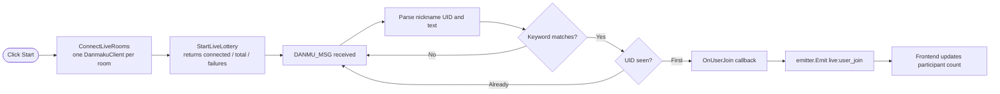
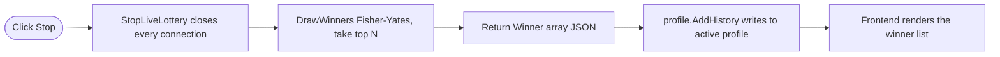
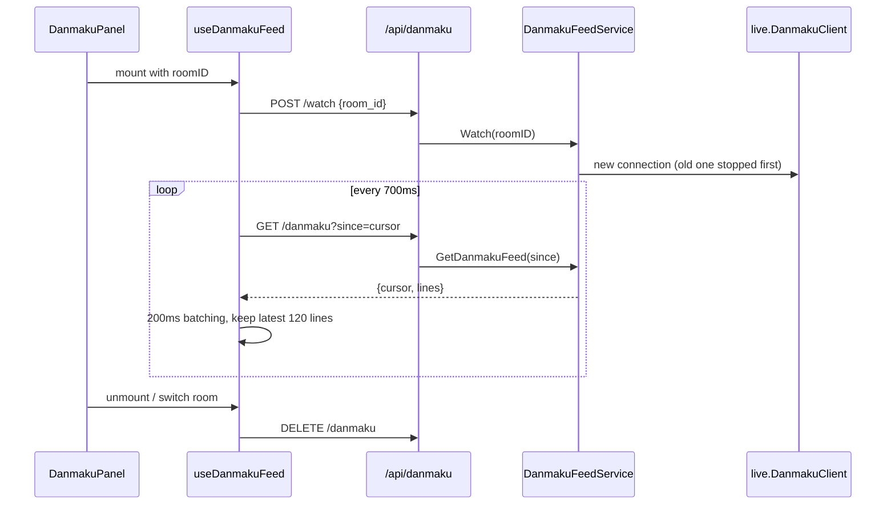
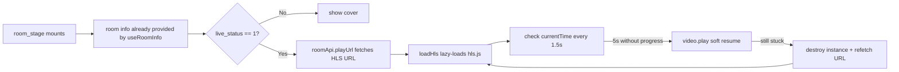
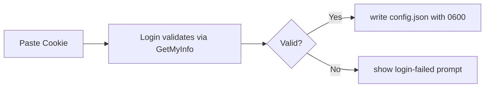
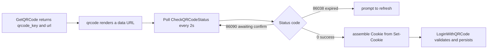
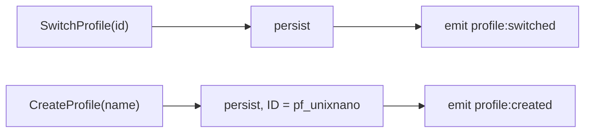

# Data Flow & Events

## Draw flow

An empty keyword makes `Match` always pass — "collect everything". Rooms that failed to connect appear in `failures` and are named in the UI instead of being silently treated as collecting.

`live:user_join` drives live counts; `useLottery` also polls every 2s as a fallback, reconciling run state and participant count after a missed event or a page reload.

## Stop and draw

A history write failure never blocks the result: the error is stashed in `lastHistoryError` and read once by the frontend via `GetLastHistoryError`.

## Danmaku panel

The emote map is fetched once (`/api/danmaku/emotes`); the server caches it for 6 hours and layers the current room's emotes on top.

## Stream playback

## Login flows

**Cookie login:**

**QR-code login:**

## Profile events

Both payloads are the `ProfileConfig` JSON string.

## Config persistence

| File | Contents |
| --- | --- |
| `~/.luckydraw/config.json` | `{Cookie}` |
| `~/.luckydraw/state.json` | `{Profiles, ActiveProfile}` |

- Keyword and winner-count changes are debounced 400ms before `SaveProfileConfig`.
- Rooms, background, profile CRUD and draw history persist immediately.
- Both files are written with `0600` inside a `0700` directory; the legacy single-profile layout migrates on read.
