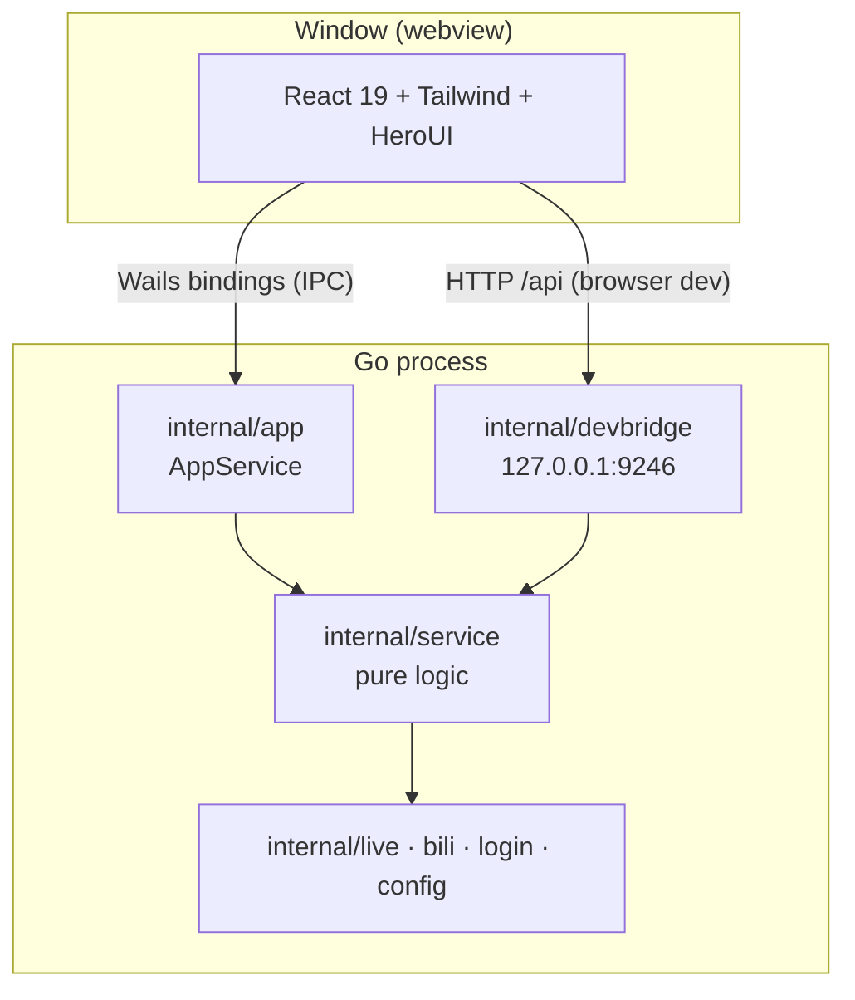
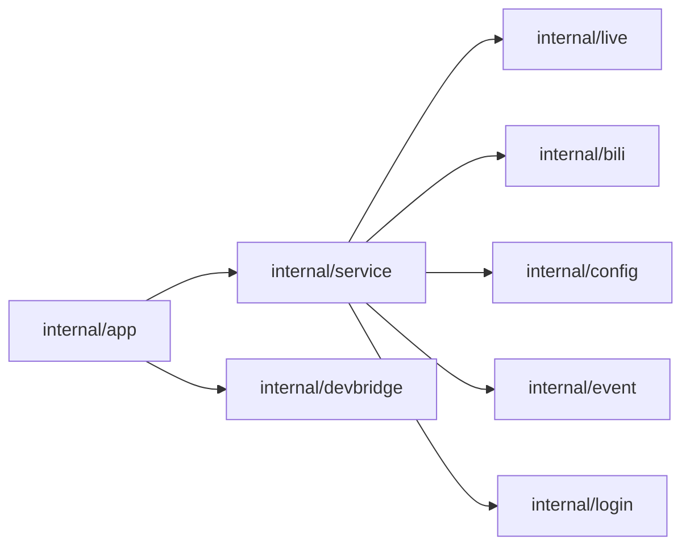

# Architecture Overview

BiliLuckyDraw is a Wails v3 desktop app: the Go backend embeds the React build output via `//go:embed all:frontend/dist` and renders it in a single 1200×800 webview window. On macOS, closing the last window quits the app; while a Vite dev server is attached the process stays alive so a browser tab can drive it.

## Shape of the system



The frontend has two transports, chosen by `fallback(remote, http)` in `services/http.ts`:

1. **Wails bindings** — the normal path inside the desktop window; `Call.ByID` reaches `AppService` directly.
2. **HTTP bridge** — used when a browser tab has no `_wails` runtime or the binding call fails. It talks to `http://127.0.0.1:9246/api/*`, and Vite proxies `/api` and `/wails` there.

Both end up in the same business code: the routes exposed by `devbridge.Transport.APIHandler()` mirror the `AppService` methods one-to-one.

## Backend layering



- `app`: the only package importing `wails/v3`. `AppService` is the single service exposed to the frontend; every method thinly delegates to `service` while owning Wails-only capabilities (window, clipboard, save dialog).
- `service`: pure Go business logic split by domain — `auth` / `live` / `profile` / `room` / `danmaku_feed` / `emote` / `history` — with no Wails dependency.
- `live`: the danmaku WebSocket binary protocol and draw aggregation, split within the package into `types` / `protocol` / `room_auth` / `parse` / `client` / `lottery`.
- `bili`: the Bilibili HTTP API client plus WBI signing.
- `config`: local JSON config read/write and legacy migration.
- `event`: the `Emitter` interface, so `service` never imports Wails; the `app` layer injects the implementation.
- `devbridge`: HTTP transport and JSON API routes for browser-based debugging.
- `cmd/devbridge`: a standalone bridge binary reusing the same routes, so no Wails runtime is needed.

## Frontend structure

Sliced by feature; every directory under `features/` owns its API, hooks and components:

```
src/
  features/
    session/     # login page, QR / cookie login, session hook
    lottery/     # lottery page, control bar, winners, draw hook
    rooms/       # room list, stream player, danmaku panel, HLS loader, emote rendering
    profiles/    # profile CRUD and switching
    settings/    # settings page and its four tabs
    history/     # history list and record component
  components/    # Panel / Icon / CachedImage / scroll hooks / Toaster
  theme/         # light-dark mode, background presets, accent extraction
  services/      # HTTP fallback, bridge probe, QR and clipboard helpers
  types/         # domain-split type declarations
  config/        # navigation config
  contexts/      # AppContext (session + profiles + lottery)
```

Pages read one merged object from `AppProvider`, which composes `useSession` (login state), `useProfiles` (config and rooms) and `useLottery` (draw state), surfaced through `useApp()`. Routing is `react-router-dom`: `/` is the lottery page, `/settings` the settings page.

## Directory layout

```
luckydraw/
  main.go                  # Wails v3 entry (embeds frontend dist)
  Taskfile.yml             # build workflow (dev/build/package/generate)
  build/                   # per-platform config, Taskfiles and icons
  cmd/devbridge/           # standalone browser bridge
  internal/
    app/                   # Wails boundary: AppService + emitter
    service/               # pure business logic
    live/                  # danmaku protocol + draw aggregation
    bili/                  # Bilibili HTTP API + WBI signing
    login/                 # QR-code login
    config/                # config persistence
    event/                 # Emitter interface
    devbridge/             # browser HTTP transport and routes
  frontend/
    src/                   # see above
    scripts/               # icon generation and checks (local only, not committed)
    bindings/              # generated by wails3 generate bindings (do not hand-edit)
```

## Runtime notes

- Single window with sidebar navigation; the sidebar becomes a drawer in narrow windows.
- On boot the frontend probes the bridge (`/api/lottery/status`) and fixes the transport for the rest of the session.
- Until the accent is sampled from the background, the theme uses a preset hue; once the image loads, canvas sampling overrides the `--heroui-primary-*` variables.
