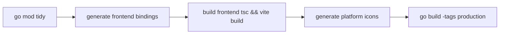

# Build & Package

## Build

```bash
cd luckydraw
task build
```

`task build` resolves to `task {{OS}}:build` (dispatching to `darwin:build` / `windows:build` / `linux:build`); output lands in `bin/`.



| Platform | Command | Output |
| --- | --- | --- |
| macOS | `task darwin:build` | `bin/luckydraw` |
| macOS universal | `task darwin:build:universal` | `bin/luckydraw` (arm64 + amd64) |
| Windows | `task windows:build ARCH=amd64` | `bin/luckydraw.exe` |
| Linux | `task linux:build` | `bin/luckydraw` |

## Package

```bash
task package                    # current OS
task darwin:package             # macOS → bin/luckydraw.app
task darwin:package:universal   # macOS universal → bin/luckydraw.app
task windows:package ARCH=amd64 # Windows → bin/luckydraw-amd64-installer.exe
```

- **macOS**: produces `bin/luckydraw.app` (bundle + ad-hoc signature). Not notarized, so the first launch needs manual approval in System Settings.
- **Windows**: `windows:package` builds the `.exe` and then runs NSIS. `makensis` is enough for cross-packaging on macOS (`brew install makensis`).
- **Linux**: `linux:package` produces a binary and a `.desktop` file; CGO builds use Docker off Linux hosts.

::: tip Cross-compilation
- Linux builds need CGO and go through the `wails-cross` Docker image (`wails3 task setup:docker` first).
- Windows builds default to `CGO_ENABLED=0`, so they cross-compile directly on macOS without Docker.
:::

## Local release (no GitHub Actions)

CI billing issues mean releases are produced locally:

```bash
cd luckydraw

# 1. frontend output + backend build (bindings and icons included)
# windows:package already depends on windows:build
task darwin:package:universal
task windows:package ARCH=amd64

# 2. collect release artifacts
mkdir -p bin/dist
ditto -c -k --sequesterRsrc --keepParent bin/luckydraw.app bin/dist/BiliLuckyDraw-darwin-universal.zip
cp bin/luckydraw-amd64-installer.exe bin/dist/
cp bin/luckydraw.exe bin/dist/luckydraw-amd64-portable.exe

# 3. checksums (list files explicitly; do not use *, or SHA256SUMS.txt hashes itself)
cd bin/dist
shasum -a 256 \
  BiliLuckyDraw-darwin-universal.zip \
  luckydraw-amd64-installer.exe \
  luckydraw-amd64-portable.exe \
  > SHA256SUMS.txt
```

| Artifact | Description |
| --- | --- |
| `BiliLuckyDraw-darwin-universal.zip` | macOS `.app`, arm64 + amd64 |
| `luckydraw-amd64-installer.exe` | Windows x64 installer (NSIS) |
| `luckydraw-amd64-portable.exe` | Windows x64 portable build |
| `SHA256SUMS.txt` | checksums for the files above |

## Frontend-only build

From `frontend/`:

```bash
npm run dev     # Vite dev server on 9245, proxies /api to 9246
npm run build   # tsc && vite build into dist/
```

`vite.config.ts` proxies `/api` and `/wails` to `127.0.0.1:9246`, so browser-only development needs `go run ./cmd/devbridge` running alongside.

## Build config

`build/config.yml` defines packaging metadata:

| Field | Value |
| --- | --- |
| companyName | aDarkMaker |
| productName | BiliLuckyDraw |
| productIdentifier | com.adarkmaker.bililuckydraw |
| version | 1.6.0 |
| copyright | (c) 2025, aDarkMaker |

The `dev_mode` section configures hot reload: ignores `node_modules` / `frontend` / `bin`, watches `*.go` / `*.js` / `*.ts`, debounce 1000ms. When bumping the version, update `build/config.yml` and the version table here.
