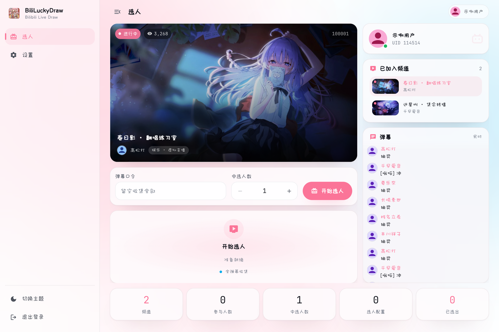
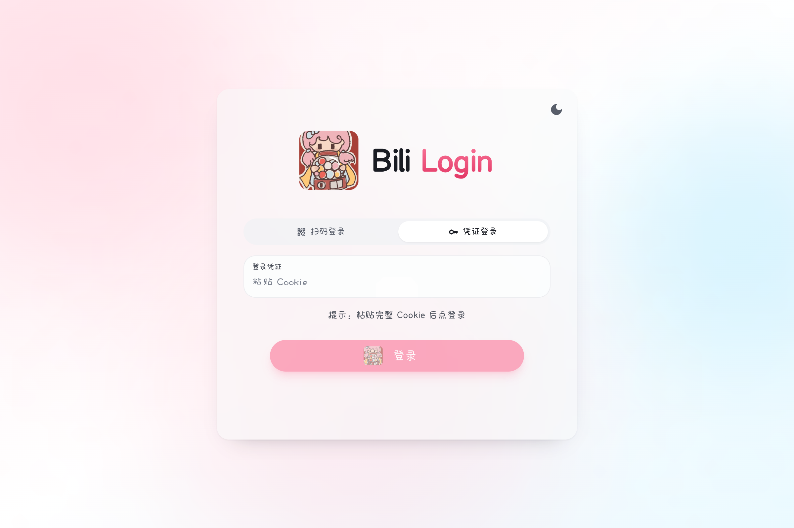
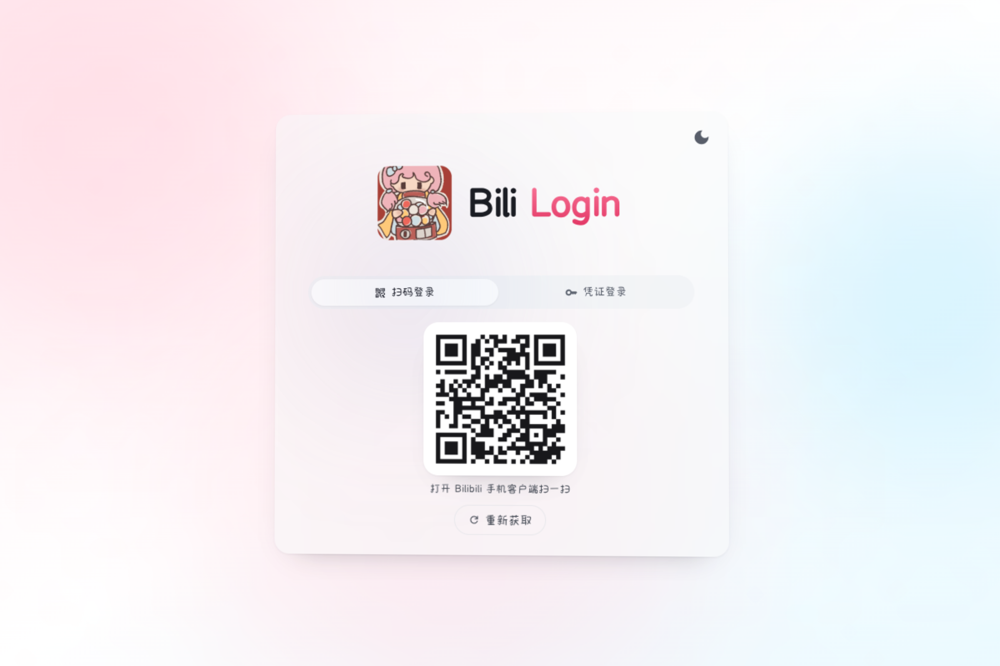
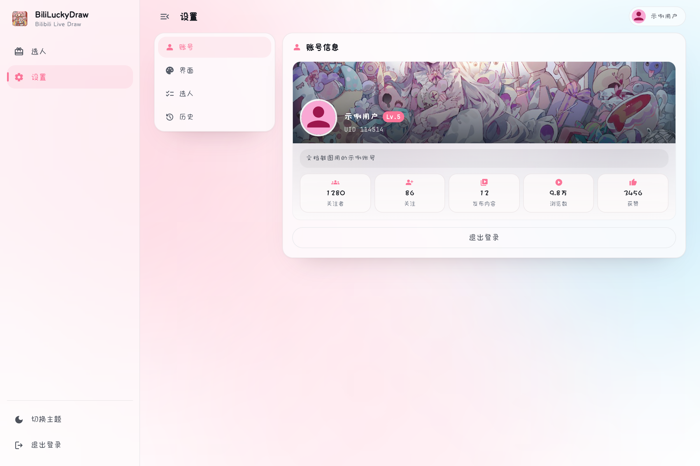
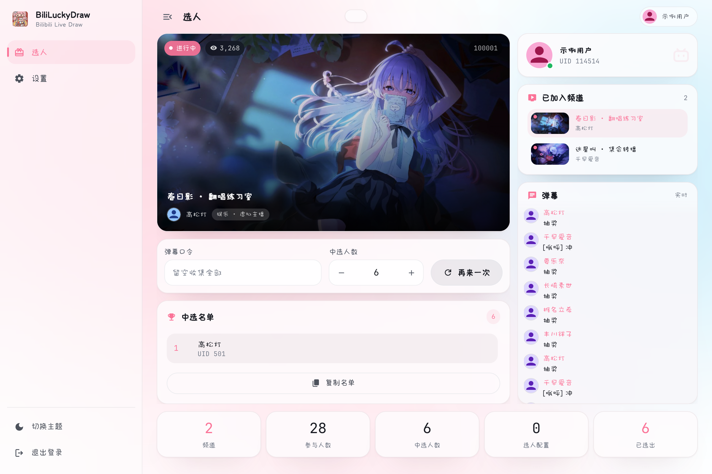
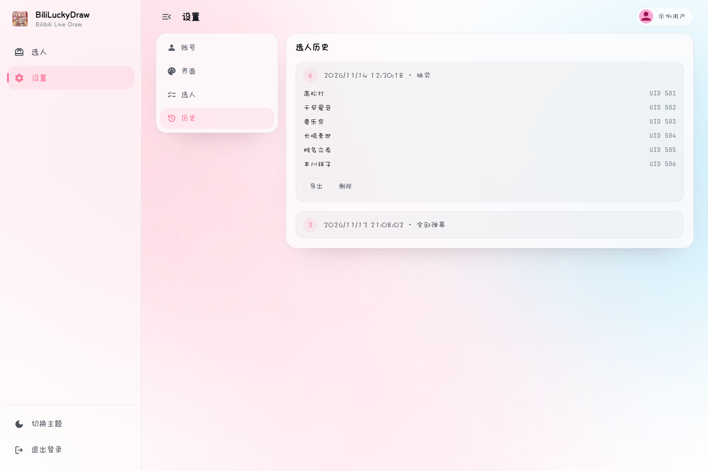

# Product

BiliLuckyDraw is a desktop app for running lucky draws in Bilibili live streams. Once connected to a room it listens to danmaku in real time: a viewer whose message contains the configured keyword is entered into the draw, and winners are picked at random from all participants. The whole process is automatic — no manual list-keeping, fair and transparent.

It also folds in the things that otherwise need several windows: the stream player, the room list, the live danmaku feed and the winner list all share one screen, so you don't juggle a browser and a spreadsheet before going live.

It's built for streamers running interactive giveaways — a daily thank-you, a fan-festival event or a holiday special — and starts collecting in seconds.

- **Repository**: [aDarkMaker/BiliLuckyDraw](https://github.com/aDarkMaker/BiliLuckyDraw)
- **Releases**: [github.com/aDarkMaker/BiliLuckyDraw/releases](https://github.com/aDarkMaker/BiliLuckyDraw/releases)
- **License**: MIT © 2025 aDarkMaker

## What it does

- Monitors danmaku in one or more live rooms in real time
- Enters viewers who send the keyword, deduplicated by UID (multiple messages in the same room count once); an empty keyword collects every danmaku
- One-click draw — randomly picks the configured number of winners and records the result in that profile's history
- Two login methods: paste a Cookie, or scan a QR code with the mobile app
- Multiple draw configs — keyword, winner count, rooms and background switch together
- Light / dark modes plus spring-festival and beach backdrops; the accent color is sampled from the active image
- Stream player and danmaku feed in the same view; the feed sticks to the bottom, pauses on scroll-up and resumes after a few idle seconds

## Screenshots

| Lottery | Cookie login | QR-code login |
| --- | --- | --- |
|  |  |  |

| Settings | Winners | Draw history |
| --- | --- | --- |
|  |  |  |

## Tech stack

| Layer | Tech |
| --- | --- |
| Backend | Wails v3 (v3.0.0-alpha.95) · Go 1.25 |
| Frontend | React 19 · TypeScript 5 · Vite 6 · Tailwind 3 · HeroUI |
| Live protocols | Danmaku WebSocket binary frames · HLS (hls.js) |
| Storage | Local JSON under `~/.luckydraw/` |

## Data stays local

Credentials, configs and history live in `~/.luckydraw/` with 0600 permissions. Nothing is uploaded, and the app intentionally provides no cloud sync or automatic prize distribution.
