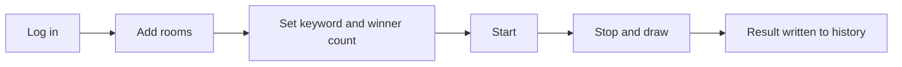

# Use Cases

## Interactive draws during a stream

The streamer starts a keyword interaction; viewers who send the keyword are auto-added to the pool, and winners are drawn at random when it stops.

While the draw runs you can watch the stream and the danmaku feed on the same screen instead of switching to a browser to check whether people are actually sending the keyword.

## Monitoring several rooms at once

The room list takes any number of rooms. `ConnectLiveRooms` opens an independent danmaku connection per room, the participant pools merge, and the draw picks from the combined pool. A room that fails to connect is named in the start notification rather than being silently ignored.

The stream preview and danmaku panel only follow the *selected* room, so switching the preview never disturbs a running pool.

## Switching configurations per scenario

Save multiple **Profiles** (draw-config sets). Each independently stores its keyword, winner count, rooms, background and history. Switching a profile switches all of it, history included.

::: tip What a Profile is
A Profile is a "draw-configuration set", **not a Bilibili account**.

- One Bilibili login (Cookie / QR) is reused by every Profile
- For example: a daily draw, a fan festival and a New-Year special each get a Profile
- Each Profile keeps its latest 100 draw records
:::

## Themed events

Light / dark mode plus background presets fit different moods:

- **Default gradient** — everyday use, brand-pink accent
- **Spring festival / Beach** — bundled images whose dominant color becomes the accent (red-ish and blue-ish respectively)

You can also upload your own background on any profile; a custom image beats the preset.

## Reviewing past draws

Every result is recorded with keyword, winner count, time and the full list. Useful for:

- Showing the list when someone questions the outcome in chat
- Exporting a Markdown archive after an event
- Comparing participation between sessions

::: warning Not supported
This is a local desktop app. It does **not** provide:

- Cloud sync of configs or history
- Auto-announcing winners to danmaku
- Automatic prize distribution

Winner lists are shown and exported locally only.
:::
