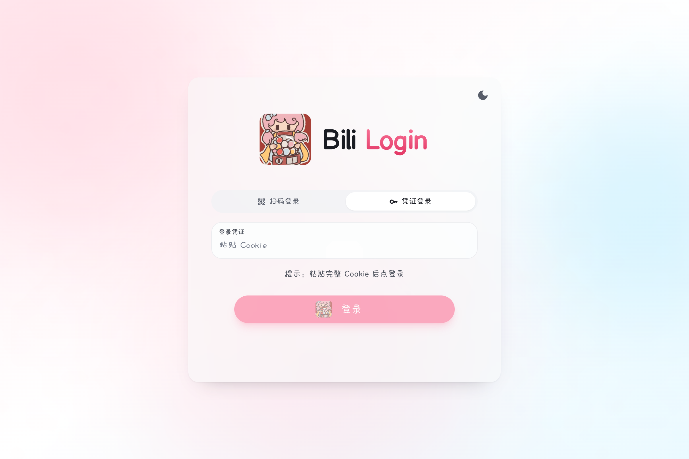
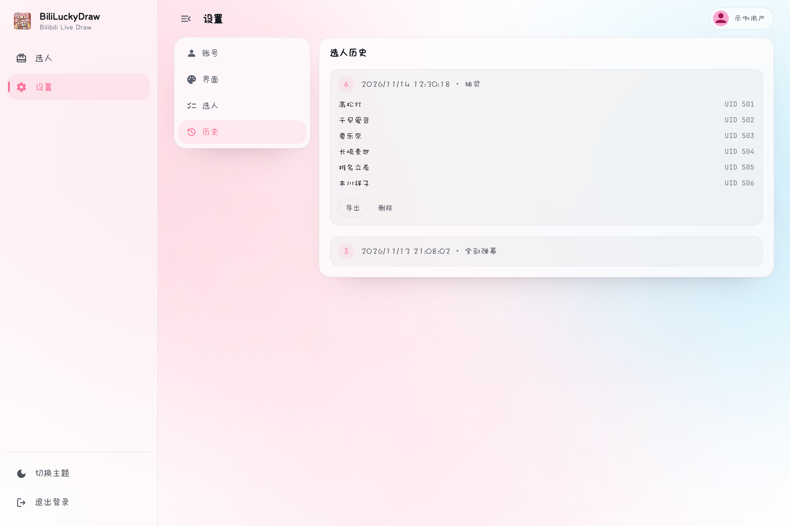

# 产品介绍

BiliLuckyDraw 是一个为 B 站直播间设计的桌面应用。开启后实时监听直播间弹幕：观众发送含指定口令的弹幕即视为参与，开奖时从所有参与者中随机抽取中奖者。整个过程自动完成，不需要人工记名单，公平透明。

除抽奖之外，它还把这几个原本要开一堆窗口的事收进同一个界面：直播画面、频道列表、实时弹幕、中奖名单。开播前不用来回切换浏览器和文档。

适合主播在日常直播、粉丝节或节日活动中即开即用。

- 仓库：[aDarkMaker/BiliLuckyDraw](https://github.com/aDarkMaker/BiliLuckyDraw)
- 下载：[Releases](https://github.com/aDarkMaker/BiliLuckyDraw/releases)
- 许可证：[MIT](https://github.com/aDarkMaker/BiliLuckyDraw/blob/main/LICENSE) © 2025 aDarkMaker

## 它能做什么

- 实时监控一个或多个直播间的弹幕
- 观众发送含口令的弹幕即视为参与，按 UID 去重（同一直播间多次发言只计一次）；口令留空则收集全部弹幕
- 一键开奖，随机抽取指定数量的中奖者，并自动写入该配置的历史记录
- 支持粘贴 Cookie 与手机扫码两种登录方式
- 多套抽奖配置随时切换，口令、人数、频道、背景一起带走
- 深浅色与春节 / 假日背景，主色调随背景图自动取色
- 同一屏内查看直播画面与实时弹幕，弹幕贴底跟随、上滚暂停、静置后自动恢复

## 界面截图

| 选人页 | 登录页 | 扫码登录 |
| --- | --- | --- |
|  |  |  |

| 设置页 | 中奖结果 | 抽奖历史 |
| --- | --- | --- |
|  |  |  |

## 技术栈

| 层 | 技术 |
| --- | --- |
| 后端 | Wails v3 (v3.0.0-alpha.95) · Go 1.25 |
| 前端 | React 19 · TypeScript 5 · Vite 6 · Tailwind 3 · HeroUI |
| 直播协议 | 弹幕 WebSocket 二进制帧 · HLS（hls.js） |
| 数据存储 | 本机 JSON（`~/.luckydraw/`） |

## 数据留在本机

登录凭证、配置与历史都写在 `~/.luckydraw/` 下，文件权限 0600，不上传任何服务器。应用本身也不提供云端同步、自动发奖等能力。
