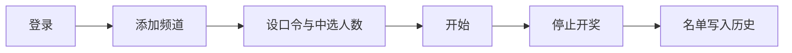

# 应用场景

## 直播互动抽奖

主播发起口令互动，观众发送含口令的弹幕即自动入池，停止后随机开奖。

抽奖期间可以在同一屏看直播画面与弹幕，不用切到浏览器确认是否有人在刷口令。

## 多频道同时监控

频道列表支持添加多个房间。`ConnectLiveRooms` 为每个房间建立独立的弹幕连接，参与者池合并，开奖时从合并池统一抽取。某个房间连接失败会在开始抽奖的提示里点名，不会静默混过去。

右侧的直播间预览与弹幕面板只跟随「当前选中」的房间，因此切换预览不会影响正在积累的参与池。

## 多场景配置切换

通过 **Profile**（抽奖配置集）保存多套配置，每套独立保存口令、中选人数、频道、背景图与历史记录。切换配置时，这些设置和历史列表一起切换。

::: tip Profile 是什么
Profile 是「抽奖配置集」，**不是 B 站账号**。

- 一次 B 站登录（Cookie / 扫码）会被所有 Profile 复用
- 例如：日常抽奖、粉丝节、新年专场各建一个 Profile
- 每个 Profile 最多保留最近 100 条开奖历史
:::

## 主题活动

深浅色模式搭配背景预设适配不同氛围：

- **默认渐变**：日常通用，主色调为品牌粉
- **春节 / 假日**：自带背景图，主色调从图片自动取色（春节偏红、假日偏蓝）

也可以在任何配置下上传自己的背景图；自定义背景优先于预设。

## 溯源与复盘

开奖结果自动写入历史，包含口令、人数、时间与完整名单。可用场景：

- 有人在弹幕里质疑结果时，直接展示历史名单
- 活动结束后把名单导出为 Markdown 存档
- 对比不同场次的参与人数变化

::: warning 当前不支持的能力
本应用是本地桌面应用，**不提供**：

- 云端同步配置与历史
- 自动把中奖者公告到弹幕
- 自动发奖

中奖名单只在本地展示与导出。
:::
